# Diagrama de Implantação

## Nós e artefatos

| Nó | Artefatos implantados | Função |
|----|-----------------------|--------|
| Dispositivo do usuário | Navegador web com a interface do sistema | Compradores e organizadores acessam o sistema, e a equipe lê os QR Codes na entrada |
| Balanceador de carga | nginx com `infra/nginx.conf` | Recebe todos os acessos e os distribui entre as réplicas da aplicação |
| Servidores de aplicação (2 réplicas) | Aplicação web (API) | Executa as regras de negócio: eventos, pedidos, ingressos, validação e notificações |
| Servidor de banco de dados | PostgreSQL com o esquema de `banco/init.sql` | Armazena usuários, eventos, pedidos, ingressos e pagamentos |
| Gateway de Pagamento (externo) | API de pagamento do provedor | Processa os pagamentos; os dados de cartão ficam só aqui (RNF-002) |

## Protocolos de comunicação

| Origem → Destino | Protocolo | Finalidade |
|------------------|-----------|------------|
| Navegador → Balanceador | HTTPS (REST/JSON) | Buscar eventos, comprar e validar ingressos |
| Balanceador → Aplicação | HTTP (proxy reverso) | Repassar cada requisição a uma réplica |
| Aplicação → Banco de dados | TCP/IP, porta 5432 (SQL) | Consultar e gravar os dados |
| Aplicação → Gateway | HTTPS (REST/JSON) | Enviar a cobrança do pedido |
| Gateway → Balanceador | HTTPS (webhook) | Informar o resultado do pagamento |

## Como atende os RNF de infraestrutura

- **RNF-001 (Escalabilidade):** o balanceador distribui o pico de acessos entre as réplicas, e mais réplicas podem ser acrescentadas sem alterar o restante.
- **RNF-003 (Disponibilidade):** se uma réplica cair, a outra continua atendendo.
- **RNF-002 (Segurança):** dados de cartão trafegam só entre o comprador e o Gateway.
- **RNF-004 (Concorrência):** com várias réplicas, a consistência do estoque é garantida pelo banco (ver ADR-002).
