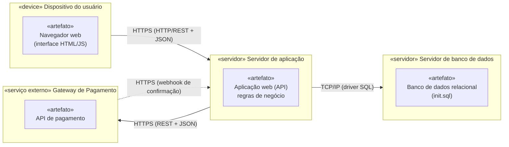

# Diagrama de Implantação

## Nós e artefatos

| Nó | Artefatos implantados | Função |
|----|-----------------------|--------|
| Dispositivo do usuário | Navegador web com a interface do sistema | Compradores e organizadores acessam o sistema, e a equipe lê os QR Codes na entrada |
| Servidor de aplicação | Aplicação web (API) | Executa as regras de negócio: eventos, pedidos, ingressos, validação e notificações |
| Servidor de banco de dados | Banco de dados relacional (esquema em `banco/init.sql`) | Armazena usuários, eventos, pedidos, ingressos e pagamentos |
| Gateway de Pagamento (externo) | API de pagamento do provedor | Processa os pagamentos; os dados de cartão ficam só aqui (RNF-002) |

## Protocolos de comunicação

| Origem → Destino | Protocolo | Finalidade |
|------------------|-----------|------------|
| Navegador → Servidor de aplicação | HTTPS (REST/JSON) | Buscar eventos, comprar e validar ingressos |
| Servidor de aplicação → Banco de dados | TCP/IP (driver SQL) | Consultar e gravar os dados |
| Servidor de aplicação → Gateway | HTTPS (REST/JSON) | Enviar a cobrança do pedido |
| Gateway → Servidor de aplicação | HTTPS (webhook) | Informar o resultado do pagamento |

**Observação:** para atender à escalabilidade (RNF-001), o servidor de aplicação pode ser replicado atrás de um balanceador de carga, sem mudar o restante do diagrama.
