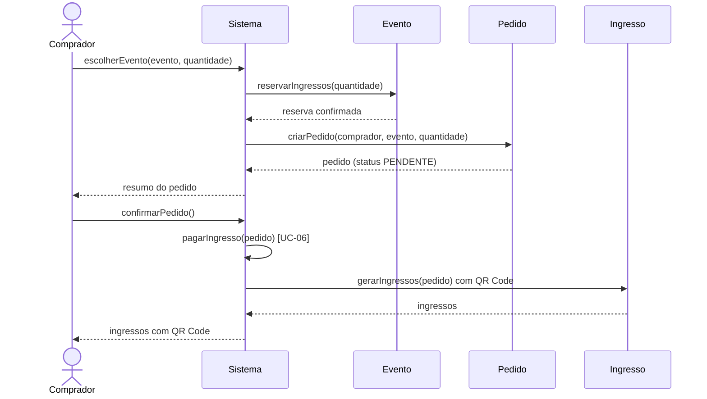
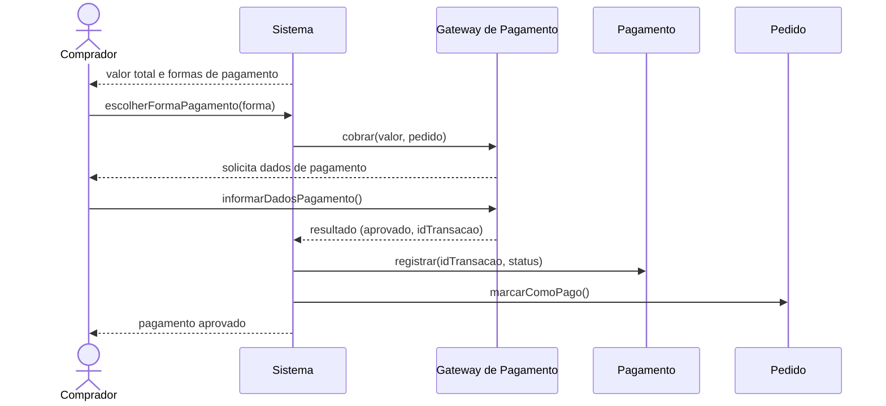

# Diagramas de Sequência

Fluxos principais de **UC-05 – Comprar ingresso** e **UC-06 – Pagar ingresso** (ver [DescricaoCasosDeUso.md](../../docs/casos-de-uso/DescricaoCasosDeUso.md)).

## UC-05 – Comprar ingresso

## UC-06 – Pagar ingresso

